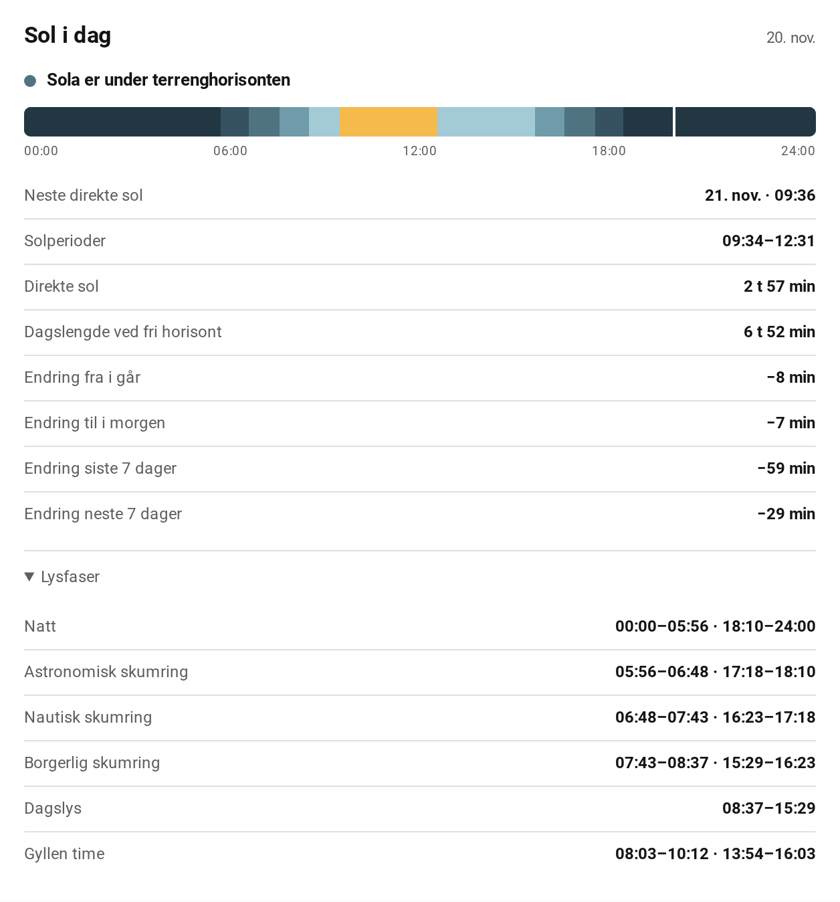

# Terrain Sun

Se når terrenget slipper sola til der du bor. Én Home Assistant-integrasjon gir entiteter for direkte sol og tre dashboardkort. Beregningene kjører lokalt i Home Assistant.

## Installer i Home Assistant

Krever Home Assistant **2026.11.2** eller nyere.

1. Åpne **Innstillinger → Marketplace → Legg til fra lenke**. Koble til GitHub hvis Home Assistant ber om det.
2. Legg til `https://github.com/stboee/ha-terrain-sun` og installer **Terrain Sun**.
3. Legg til **Terrain Sun** under **Innstillinger → Enheter og tjenester**. Velg `horizon.txt` fra PeakFinder (**Export → Horizon for Stellarium**).
4. Last inn Home Assistant-fanen på nytt etter oppsettet. Rediger dashboardet, åpne **Legg til kort → Etter kort** og søk etter **Terrain Sun**.

For en første gjennomgang kan du bruke [eksempelprofilen fra Øyer](examples/horizon.txt), basert på vinkelverdier fra PeakFinder. Eksempelfilen bruker Home Assistant sin plassering. En PeakFinder-eksport med koordinater bruker utsiktspunktet i eksporten. Begge bruker tidssonen fra Home Assistant. For å bytte profil velger du **Konfigurer på nytt** på integrasjonen og laster opp en ny fil.

Marketplace henter oppdateringer fra GitHub Releases. Start Home Assistant på nytt når Marketplace ber om det. Terrengprofilen ligger i integrasjonens konfigurasjon og følger med ved oppdatering.

## Kort

| Kort | Innhold | Type i YAML |
|---|---|---|
| **Sol i dag** | Status, neste overgang, døgnstripe, solperioder, dagslengde og utvidbare lysfaser. Viser endringer i direkte soltid fra i går, til i morgen og for siste og neste 7 dager. | `custom:terrain-sun-today` |
| **Lokal horisont** | Viser terreng, solbane og direkte solperioder for valgt dato. Velg mellom **Utsnitt**, **360°**, **Solbane** og **Månebane**. | `custom:terrain-sun-horizon` |
| **Solåret** | Årsgraf i klokkeslett- og varighetsvisning, datovelger, døgnstripe, neste dato med tilsvarende soltid, solverv og valgfritt klokkeslett for kveldssol. | `custom:terrain-sun-year` |

**Neste gang det er så lyst** sammenligner samlet direkte soltid for valgt dato med dagene etter neste solverv. Kortet viser datoen som ligger nærmest ved første tilbakekomst til omtrent samme soltid. Har valgt dato ingen direkte sol, viser kortet første kommende dato med direkte sol, innen ett år. I sjudagersradene sammenlignes dagens direkte soltid med datoene nøyaktig 7 dager før og etter.

Kort kan også legges til med typen i tabellen. Etter en oppdatering laster du inn Home Assistant-fanen på nytt. Integrasjonen registrerer kortfilen automatisk, også når dashboardressurser styres fra YAML. En eksisterende YAML-oppføring med `/terrain_sun/terrain-sun.js` og typen `module` kan brukes videre.

### Innstillinger for Lokal horisont

| Visning | Utsnitt |
|---|---|
| **Utsnitt** | Terreng og solbane rundt retningen der sola står høyest. |
| **360°** | Terreng og solbane rundt hele kompasset, med høydeaksen tilpasset terrengprofilen og solas toppunkt. |
| **Solbane** | Hele solbanen for valgt døgn, også under terrenget. Begge aksene tilpasses banen og terrengprofilen i utsnittet. |
| **Månebane** | Hele solbanen og månebanen for valgt døgn. Begge aksene utvides etter behov, og månebanen vises som en lilla kurve. |

Banene går fra lokal midnatt til neste midnatt. Start og slutt kan ligge på forskjellige steder i grafen.

**Vis skumring** er et eget valg i alle fire visninger. Fargebåndene vises innenfor grafens eksisterende gradgrenser. Aksene og kurvene beholder posisjon og skala når du veksler. Solbanen viser solsentrum, mens periodene med direkte sol beregnes ved øvre solrand mot terrenget.

Velg innstillingene i den visuelle kortredigeringen, eller bruk de tilsvarende YAML-feltene.

| Innstilling | Felt i YAML | Standard og virkemåte |
|---|---|---|
| Grafhøyde | `graph_height` | Høy (`tall`). Velg eventuelt Kompakt (`compact`) eller Normal (`normal`). |
| Nedre og øvre gradgrense | `min_elevation`, `max_elevation` | Gjelder **Utsnitt** og **360°**. Tomme felt skaleres automatisk. Lås begge for å sammenligne datoer med samme målestokk. |
| Startvisning | `horizon_view` | Utsnitt (`area`). De andre valgene er 360° (`circle`), Solbane (`sun`) og Månebane (`moon`). Eldre kort med `fixed_sun: true` eller aliaset `center_sun: true` åpner i **Solbane** dersom `horizon_view` ikke er angitt. |
| Vis skumring | `show_twilight` | Av ved åpning. Båndene bruker samme astronomiske grenser og farger som **Solåret**. |
| Vis månen | `show_moon` | Av. Viser en markør for månens nåværende posisjon på dagens dato når den er innenfor figuren. **Månebane** beregner hele kurven for valgt døgn uavhengig av denne innstillingen. Måneposisjonene beregnes lokalt med [Astronomy Engine](https://pypi.org/project/astronomy-engine/). |

### Skjermbilder

Kortene er vist i Home Assistant med [eksempelprofilen fra Øyer](examples/horizon.txt).

#### Sol i dag

#### Lokal horisont

#### Solåret

## Entiteter og beregninger

- Binærsensoren **Direkte sol** viser om øvre solrand er over terrengprofilen. Sensoren **Neste overgang for direkte sol** gir et tidsstempel for første overgang innen utgangen av neste lokale døgn, når en slik overgang finnes.
- Sensorer gir dagens direkte soltid og dagslengde ved fri horisont i minutter, samt solas geometriske høyde, azimut og terrenghøyden i solretningen. Nåverdiene oppdateres omtrent hvert minutt.
- Terrengprofilen interpoleres lineært rundt hele kompasset. Solposisjonen følger NOAA/Meeus-modellen. Direkte sol bruker tilsynelatende øvre solrand med standard refraksjon og en solradius på 0,26667°. Standard soloppgang og solnedgang bruker −0,833° geometrisk solhøyde. Skumringsgrensene er −6°, −12° og −18°.
- Modellen søker etter kryssinger i trinn på ett minutt og beregner tidspunktet for kryssinger mellom søkepunktene til nærmeste hele sekund. Svært korte perioder kan falle mellom søkepunktene. Beregnet direkte soltid er summen av alle synlige perioder i døgnet. Tider vises i lokal tid, mens varigheter beregnes i faktisk medgått tid.
- Tidene beskriver terrengskygge ved utsiktspunktet. Faste hindringer inngår slik de er representert i horisontprofilen. Observert direkte sol vil også avhenge av skydekke og lokale hindringer.

Solarberegningen er basert på [NOAA Solar Calculator](https://gml.noaa.gov/grad/solcalc/calcdetails.html). Den reelle horisontprofilen må passe til stedet du ønsker å beregne for.

## Versjonsbeskrivelser

Legg til `docs/releases/v<VERSJON>.md` med endringene for brukerne i samme commit som oppdaterer `version` i manifestet. Publiseringen bruker teksten fra filen i både Git-taggen og GitHub-releasen. [Publiserte versjoner](https://github.com/stboee/ha-terrain-sun/releases)
